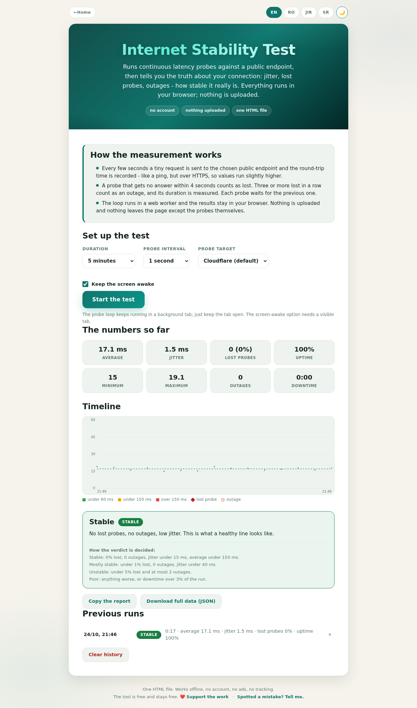

# Internet Stability Test

**Is your connection solid, or just fast?**

A speed test tells you how fast your line is on its best second. This one stays on for minutes or hours and tells you the truth: how much the latency jumps, how many probes never come back, when the connection dropped and for how long. It runs entirely in the browser and the results never leave it.

---

## What it does

- **Continuous probes.** A tiny HTTPS request every 1-10 seconds, to Cloudflare, Google or this site, each with its round-trip time recorded.
- **The stability numbers.** Average, minimum and maximum latency, jitter (the mean step between consecutive probes), lost-probe percentage, uptime, outage count and total downtime - live, and in the final report.
- **Outage detection.** Three or more probes lost in a row count as an outage. Each outage is timed and shaded red on the timeline.
- **A timeline that tells the story.** Every probe is a dot, coloured by latency; lost probes are red crosses; outage bands run the full height of the chart.
- **A verdict that shows its rules.** Stable, mostly stable, unstable or poor - with the exact thresholds written underneath, because a rating you cannot check is marketing.
- **Export and history.** A copyable text report for your provider, a full JSON of every probe, and the last twelve runs kept in this browser.
- **Four languages.** English, Romanian, Serbian Latin and Serbian Cyrillic. Light and dark. One HTML file, zero dependencies - it even runs from a USB stick.

## How the measurement works (the honest version)

- The probe is an HTTPS round-trip, not an ICMP ping: expect slightly higher values than in a command line.
- A probe with no answer within four seconds is lost. Each probe waits for the previous one.
- The loop runs in a web worker, so a background tab does not slow it down; keep the tab open.
- Nothing is uploaded. The only requests leaving the page are the probes themselves.

## The verdict thresholds

| Verdict | Rule |
| --- | --- |
| Stable | 0% lost, 0 outages, jitter under 15 ms, average under 150 ms |
| Mostly stable | under 1% lost, 0 outages, jitter under 40 ms |
| Unstable | under 5% lost, at most 2 outages |
| Poor | anything worse, or downtime over 3% of the run |

The verdict appears from the tenth probe and updates live until you stop.

## How to use it

1. Pick a duration (5 minutes to unlimited) and a probe interval.
2. Press Start and leave the tab open.
3. Watch the numbers, or stop and read the verdict.
4. Copy the report - or download the full JSON - and hand it to your provider if the line is theirs to fix.

## License & support

Apache 2.0 - see [LICENSE](LICENSE).

The tool is free and stays free. If it saved you an argument with your provider: [Support the work](https://PayPal.me/TekiDeki).
